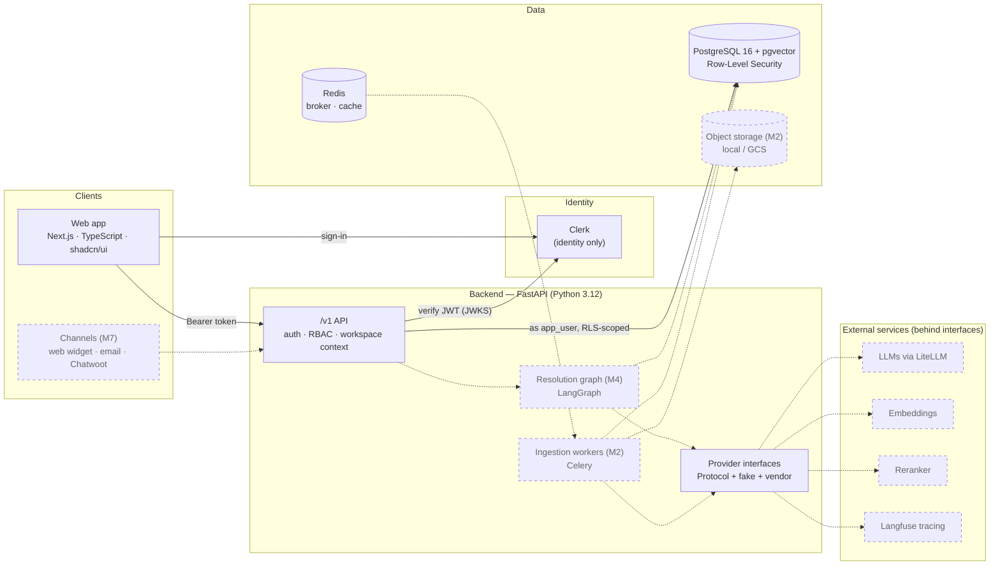
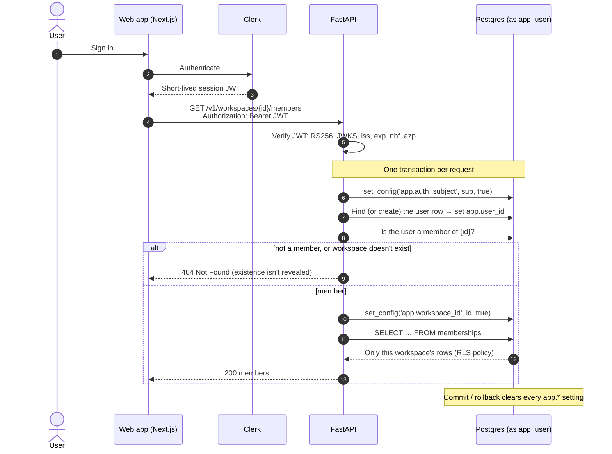
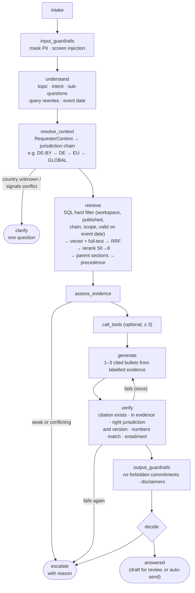

# Ticket Resolver

[](https://github.com/VishvendraTomar/Ticket_resolver/actions/workflows/ci.yml)

A multi-tenant SaaS that resolves support tickets from a company's own policy
documents, with answers that are correct **for the person asking**: their
country (and state), worker type, legal entity, and the date the event
happened.

Most support bots give vague answers and hand off constantly. Ticket Resolver
aims to answer in **1–3 short bullets, each citing the exact clause and policy
version it came from**. When the evidence isn't good enough, it asks one
clarifying question or hands off to a human. It never guesses.

> **Status: Milestone 1 (Foundation) is complete.** Auth, workspaces, roles,
> Postgres Row-Level Security with cross-tenant tests, a web shell, Docker
> Compose and CI are built and verified. The knowledge base, retrieval and
> resolution pipeline (M2–M4) are designed but **not built yet**. Diagrams
> below mark what exists today and what is planned.

---

## Contents
- [What it does](#what-it-does)
- [Principles](#principles)
- [Roadmap and status](#roadmap-and-status)
- [Architecture](#architecture)
- [How a request flows today (M1)](#how-a-request-flows-today-m1)
- [How a ticket will be resolved (M2–M4)](#how-a-ticket-will-be-resolved-m2m4)
- [Repository layout](#repository-layout)
- [Getting started](#getting-started)
- [Testing and CI](#testing-and-ci)
- [Configuration](#configuration)
- [Documentation](#documentation)

---

## What it does

A worker in Bavaria asks: *"How many days of annual leave do I get, and does
unused leave carry over?"*

1. **Who is asking?** Ticket Resolver builds a requester context (country
   `DE`, state `DE-BY`, employee, legal entity, event date) and the
   jurisdiction chain `DE-BY → DE → EU → GLOBAL`.
2. **Which policies may apply?** Only documents published for that chain and
   scope, valid on that date, are searchable. This is enforced in the SQL
   query, not left to semantic similarity.
3. **Answer, cite, verify.** It drafts 1–3 bullets from that evidence. A
   verifier checks that every bullet cites a real clause from the right
   jurisdiction and version, and that every number appears in the source.
4. **Or don't.** If the country is unknown it asks. If evidence is weak or
   conflicting, it escalates to a human with the reason.

Every answer is auditable: inputs, evidence, policy versions, model, prompt
version, and the checks that passed.

First customers: global HR, EOR, payroll, staffing and workforce platforms.
After that, any company whose support answers change by country.

## Principles

1. **Scope before search.** The requester's context decides which documents
   are allowed, and the database query enforces it.
2. **No evidence, no answer.** Weak or conflicting evidence means clarify or
   escalate.
3. **Short and cited.** 1–3 bullets plus an optional next step, and every
   bullet is cited.
4. **A deterministic pipeline**, not free-roaming agents: fixed steps sharing
   one typed state.
5. **Measure everything.** No retrieval, prompt or model change ships without
   an evaluation run.
6. **Tenant isolation is absolute.** It's enforced in the database and tested
   on every build.
7. **Cheap by default.** Small models wherever possible, and cost per ticket
   is tracked.

## Roadmap and status

| Milestone | Scope | Status |
|-----------|-------|--------|
| **M1 Foundation** | Auth, workspaces, roles, RLS + cross-tenant tests, web shell, Docker Compose, CI | ✅ Done |
| M2 Knowledge base | Upload, parsing, sections, chunking, tagging, versions, publish, coverage map | Planned |
| M3 Retrieval | Requester context, jurisdiction chain, filtered hybrid search, rerank, precedence | Planned |
| M4 Resolution | LangGraph flow, structured answers, verifier, guardrails, handoff, test console | Planned |
| M5 Evaluation | Golden set with traps, DeepEval/RAGAS, CI quality gate | Planned |
| M6 Review and analytics | Review inbox, feedback, analytics, API keys, cost tracking | Planned |
| M7 Integration and launch | Web widget, email intake, Chatwoot, live-data tools, sign-up | Planned |

Quality gates use real providers. For example, M3 needs recall@8 ≥ 0.90 and
zero out-of-jurisdiction chunks, and M4 needs citation precision ≥ 0.95. See
[docs/PLAN.md](docs/PLAN.md). Progress is tracked in
[docs/PROGRESS.md](docs/PROGRESS.md).

## Architecture



Solid lines exist today. Dashed lines and boxes are planned.

**Key design choices** (each recorded as an ADR):

- **Tenant isolation in Postgres, not just in code**
  ([ADR-0002](docs/adr/0002-row-level-security.md)). The app connects as
  `app_user` (NOSUPERUSER, NOBYPASSRLS), which owns no tables. Every tenant
  table has `ENABLE` + `FORCE ROW LEVEL SECURITY`. The workspace context is
  set per transaction with `set_config(..., is_local => true)`, so it can't
  leak through the connection pool. If no context is set, queries return
  zero rows (fail closed).
- **Clerk for identity only** ([ADR-0003](docs/adr/0003-clerk-identity-only.md)).
  Clerk answers "who is this?". Workspaces, memberships and roles live in
  our database, behind RLS.
- **Every external service behind an interface with a fake**
  ([ADR-0004](docs/adr/0004-provider-interfaces.md)). Tests run offline,
  free and deterministic. Vendors can be swapped by configuration.
- **Local Docker Compose Postgres**
  ([ADR-0005](docs/adr/0005-local-docker-postgres.md)). The same
  `pgvector/pgvector:0.8.1-pg16` image runs locally and in CI.

## How a request flows today (M1)

This is what happens when someone opens a workspace's members page.



**Defence in depth.** If a query forgets `WHERE workspace_id = …`, the RLS
policy still filters it. If a new table ships without RLS, a catalog test
fails the build. If a new route ships without a cross-tenant test, the route
suite fails the build. The full list is in
[docs/failure-modes/tenancy.md](docs/failure-modes/tenancy.md) (28 failure
modes, each with the test that proves it).

**Roles:** owner, admin, policy_editor, agent, viewer, integrator. Owners and
admins manage members. Only owners can grant or change the owner role. A
workspace always keeps at least one owner.

## How a ticket will be resolved (M2–M4)

> Designed in [docs/SPEC.md](docs/SPEC.md) and [docs/PLAN.md](docs/PLAN.md).
> **Not built yet.**

### 1. Knowledge base ingestion (M2)

```mermaid
flowchart LR
    UP["Upload document"] --> HASH["Store original + hash<br/>(skip duplicates)"]
    HASH --> Q["Queue job<br/>(Celery, idempotent)"]
    Q --> PARSE["Parse with structure<br/>headings · clauses · tables"]
    PARSE --> OCR["OCR if needed<br/>(confidence score)"]
    OCR --> SEC["Split into sections<br/>heading path + clause no."]
    SEC --> CHUNK["Chunk 300–500 tokens<br/>never split a table or clause"]
    CHUNK --> HDR["Prepend context header<br/>doc › jurisdiction › clause"]
    HDR --> TAG["AI suggests jurisdiction,<br/>scope and topic tags"]
    TAG --> HUM{"Human confirms"}
    HUM --> EMB["Embed in batches<br/>(reuse unchanged chunks)"]
    EMB --> IDX["Index: pgvector HNSW<br/>+ full-text"]
    IDX --> PUB["Editor publishes version"]
```



Policies are organised by jurisdiction (Global → Region → Country → State)
plus custom scope fields, with versions and effective dates. A database
constraint blocks overlapping published versions.

### 2. Resolving a ticket (M3 retrieval + M4 resolution)

A fixed LangGraph graph. All nodes share one typed `ResolutionState` and
communicate only through it.



Every node writes its inputs, outputs, timing and cost to an audit trace. The
answer is structured output, validated with Pydantic:

```json
{
  "status": "answered",
  "bullets": [
    { "text": "You get 30 working days of annual leave per year.", "citation_ids": ["c_8f2…"] },
    { "text": "Up to 5 unused days carry over and must be taken by 31 March.", "citation_ids": ["c_91a…"] }
  ],
  "next_step": "Request carry-over in the HR portal before 31 December.",
  "jurisdiction_used": ["DE-BY", "DE"],
  "versions_used": ["leave-policy-de@2026-01-01"],
  "partial": false
}
```

Confidence is calibrated on an evaluation set from the evidence score,
verifier results and sub-question coverage, not the model's self-rating.

## Repository layout

```
.
├── backend/                 FastAPI app (Python 3.12, uv)
│   ├── app/
│   │   ├── api/v1/          HTTP routes
│   │   ├── core/            settings, DB engine + RLS context, logging, errors
│   │   ├── providers/       external-service interfaces: base.py, fake.py, <vendor>.py
│   │   │   └── auth/        AuthVerifier: Clerk (JWKS) + fake
│   │   └── tenancy/         workspaces, users, memberships, roles, service layer
│   ├── alembic/             migrations (0001: tables, app_user role, RLS)
│   ├── tests/               unit/ · tenancy/ (RLS, catalog, cross-tenant, members)
│   └── Dockerfile
├── web/                     Next.js App Router, TypeScript, Tailwind, shadcn/ui
│   └── src/
│       ├── app/             sign-in, onboarding, /w/[workspaceId]/members
│       ├── components/      workspace shell + switcher, forms, ui/
│       └── lib/             API client, auth (Clerk + fake), role rules
├── seed/demo_m1.py          M1 demo: two workspaces, A cannot see B
├── docs/
│   ├── SPEC.md · PLAN.md · PROGRESS.md
│   ├── adr/                 architecture decision records
│   └── failure-modes/       how each component fails, and the test that proves it
├── compose.yaml             Postgres + pgvector, Redis (+ api/web with --profile app)
├── .devcontainer/           Codespaces: Python 3.12 (uv), Node LTS, Docker-in-Docker
└── .github/                 CI workflow, Dependabot
```

## Getting started

### Option A: GitHub Codespaces / devcontainer (recommended)

Open the repo in a Codespace. `.devcontainer/post-create.sh` sets everything
up: it writes a local `.env` with random passwords, installs Python and Node
dependencies, starts Postgres and Redis, runs migrations and installs the git
hooks. Then:

```bash
cd backend && uv run uvicorn app.main:app --reload   # API on :8000
cd web && npm run dev                                # web on :3000
```

Without Clerk keys, the web app uses a **development sign-in**: enter any
email to sign in as that person.

### Option B: by hand

Prerequisites: Docker, [uv](https://docs.astral.sh/uv/), Node 24 LTS.

```bash
cp .env.example .env          # set POSTGRES_PASSWORD and APP_DB_PASSWORD; AUTH_PROVIDER=fake for local
docker compose up -d          # Postgres 16 + pgvector, Redis

cd backend
uv sync
uv run alembic upgrade head   # creates tables, RLS policies and the app_user role
uv run uvicorn app.main:app --reload

cd ../web
npm ci
npm run dev                   # http://localhost:3000
```

### See tenant isolation in action

```bash
cd backend && uv run python ../seed/demo_m1.py
```

This creates two workspaces (*Northwind Global* and *Contoso Benefits*) with
people in each. It then runs 15 checks through the API and in raw SQL as
`app_user`, showing that workspace A can't read or change B's data. It's safe
to re-run.

### Everything in containers

```bash
docker compose --profile app up -d --build   # migrate (one-shot), api :8000, web :3000
```

Only the one-shot `migrate` container receives owner database credentials.
The `api` container gets `app_user` only.

## Testing and CI

```bash
cd backend
uv run pytest                              # 86 tests: unit + RLS/catalog/cross-tenant (needs Postgres)
uv run ruff check . ../seed && uv run mypy app

cd web
npm run lint && npm run typecheck && npm test && npm run build

pre-commit run --all-files                 # same checks as the git hooks
```

Database tests skip with a reason if no database is configured. CI sets
`REQUIRE_DB_TESTS=1`, so a missing database **fails** the build instead of
skipping the isolation suite.

GitHub Actions ([ci.yml](.github/workflows/ci.yml)) runs three jobs on every
push and PR:

| Job | What it checks |
|-----|----------------|
| `backend` | ruff, format, mypy strict, migration upgrade → downgrade → upgrade, pytest against a pgvector Postgres service |
| `web` | eslint, typecheck, Vitest, production build |
| `images` | compose config, API and web Docker image builds |

Actions are pinned to commit SHAs. Dependabot keeps actions, Python, npm and
Docker dependencies up to date.

## Configuration

All configuration is via environment variables in one repo-root `.env` (see
[.env.example](.env.example)). The most important ones:

| Variable | Purpose |
|----------|---------|
| `ENVIRONMENT` | `local` · `test` · `staging` · `production` |
| `POSTGRES_PASSWORD`, `APP_DB_PASSWORD` | Owner and `app_user` passwords. The URLs below are built from them |
| `DATABASE_URL` | Owner role: migrations and catalog tests only, never the running app |
| `APP_DATABASE_URL` | `app_user` (NOBYPASSRLS): everything the app does |
| `AUTH_PROVIDER` | `clerk` or `fake` (fake is refused outside local/test) |
| `CLERK_ISSUER`, `CLERK_AUTHORIZED_PARTIES` | Clerk token checks. Both are required with Clerk outside local/test |
| `NEXT_PUBLIC_API_URL` | Where the browser reaches the API |
| `NEXT_PUBLIC_CLERK_PUBLISHABLE_KEY` | Enables Clerk sign-in in the web app. Empty = dev sign-in |

Never commit `.env`. A pre-commit hook blocks it.

## Documentation

| Document | What's in it |
|----------|--------------|
| [docs/SPEC.md](docs/SPEC.md) | Full product and technical specification |
| [docs/PLAN.md](docs/PLAN.md) | Milestone breakdown, agreed spec changes, quality gates |
| [docs/PROGRESS.md](docs/PROGRESS.md) | What's done, decisions to review, open items, next step |
| [docs/adr/](docs/adr/) | Architecture decisions: RLS, auth, provider interfaces, local Postgres |
| [docs/failure-modes/](docs/failure-modes/) | How each component fails, how we detect it, and the test that proves it |
| [CLAUDE.md](CLAUDE.md) | Working rules and commands for development |

**Stack:** Python 3.12 · FastAPI · Pydantic v2 · SQLAlchemy 2 (async) ·
Alembic · uv · PostgreSQL 16 + pgvector · Redis · Celery · LangGraph ·
LiteLLM · Next.js · TypeScript · Tailwind · shadcn/ui · Docker Compose.
Planned hosting: GCP europe-west3 (Cloud Run, Cloud SQL, Memorystore, Cloud
Storage).
